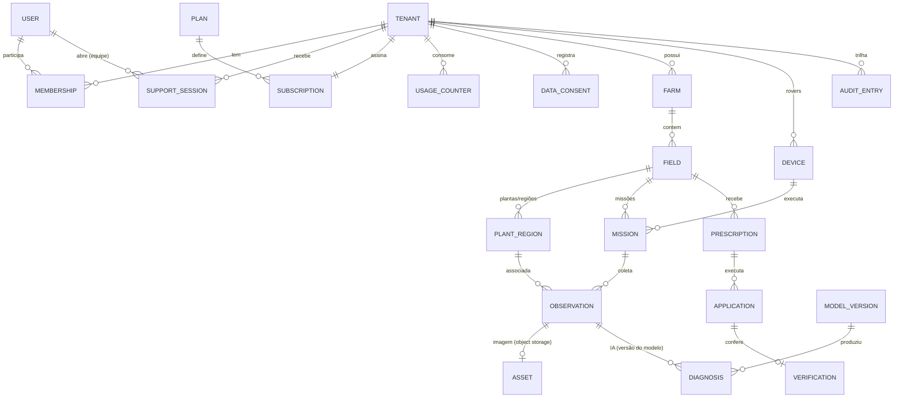
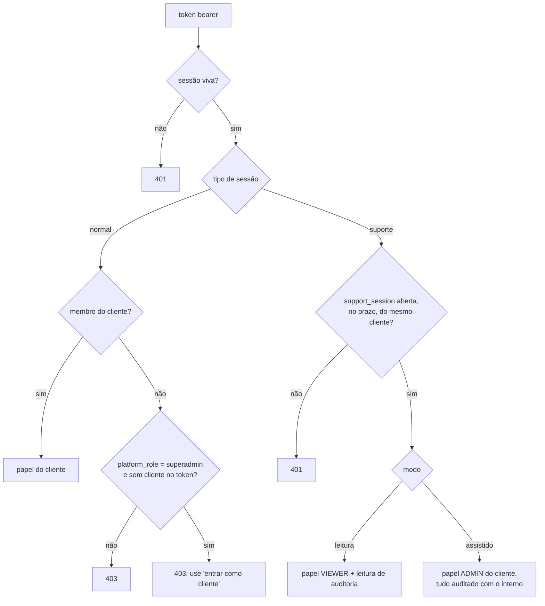

# Arquitetura alvo da plataforma ValTexa — Fase 1

> 02/10/2026. Parte da auditoria (`docs/AUDITORIA.md`) e do brief
> (`docs/BRIEF_PLATAFORMA.md`). Diz **onde cada coisa mora neste repositório**, como as partes
> conversam e em que ordem se chega lá sem quebrar o que funciona. O que já existe está
> marcado **(existe)**; o que é novo, **(novo)**.

---

## 1. Os sete componentes e as pastas reais

```mermaid
flowchart TB
  subgraph A["A · VALTEXA SAAS — saas/web + saas/valtexa/api/routers (cliente)"]
    WEBC[Console do cliente<br/>saas/web/src/pages]
  end
  subgraph CI["Console interno — saas/web/src/pages/admin → /plataforma"]
    WEBP[Console da plataforma]
  end
  subgraph E["E · VALTEXA API/BACKEND — saas/valtexa"]
    AUTH[auth · rbac · tenancy<br/>platform_roles · support_sessions · plans · consent]
    DOM[domínio: fazendas, talhões, missões,<br/>percepção, prescrição, aplicação]
    FLEET[Fleet Management<br/>fleet.py · device_protocol.py]
    EVT[outbox + worker]
  end
  subgraph B["B · VALTEXA AI PLATFORM — ia/"]
    INF[inferência cloud<br/>ia/app/main.py · rover_api.py]
    FUS[fusão por planta · incidência · prescrição<br/>ia/app/plant_fusion.py · fields_api.py · prescricao.py]
    REG[Model Registry (novo)<br/>ia/app/registry.py → ia/platform/]
    TRN[treino · validação · dNATY<br/>ia/training/]
  end
  subgraph C["C · VALTEXA ROVER RUNTIME — rover/ (novo)"]
    RT[core · mission · sync · storage · telemetry<br/>health · ota · config · security]
    HAL[HAL: câmera, GPS, IMU, rede, acelerador]
  end
  subgraph D["D · VALTEXA EDGE AI — rover/valtexa_rover/edge_ai (novo)"]
    EDGE[engine: pré-proc → inferência → decisão de retenção<br/>reusa ia/app/inference + onnx_runtime]
  end
  subgraph F["F · INFRA DE DADOS"]
    PG[(Postgres: metadados)]
    S3[(Object storage: imagens, datasets,<br/>artefatos de modelo, relatórios)]
  end
  subgraph G["G · OBSERVABILIDADE (Parte 7)"]
    OBS[métricas · logs estruturados · alertas]
  end
  WEBC --> E
  WEBP --> E
  E --> B
  FLEET <--> C
  C --> D
  E --> PG
  E --> S3
  B --> S3
  E -.-> OBS
  B -.-> OBS
  C -.-> OBS
```

| Componente do brief | Onde mora | Estado |
| --- | --- | --- |
| **A · SaaS** (cliente) | `saas/web/src/pages/*` + rotas `/v1/**` de cliente | existe; ganha planos, consentimento, talhão completo (Fase 2), fluxos guiados (F4–F5) |
| **Console interno** (seção 28) | `saas/web/src/pages/admin/*` → vira `/plataforma`; rotas `/v1/admin/**` e `/v1/platform/**` | existe parcial; papéis de plataforma e "entrar como cliente" na Fase 2 (backend), telas na F3 |
| **B · AI Platform** | `ia/` (VALTEXA-B): `app/` inferência e fusão, `training/` treino; Model Registry novo em `ia/app/model_registry.py` (F7) | existe parcial |
| **C · Rover Runtime** | `rover/valtexa_rover/` **(F9–F11, Parte 4)**: `runtime/` (core, mission, model_manager, events, store, buffer, retention, sync, health, logs, client), `hal/`, `config.py`, `cli.py`; **Parte 5**: `runtime/ota.py` + `launcher.py` (OTA), `sim/` (simulador e estresse), `cli servico` + `deploy/` (systemd) — ver `docs/ROVER_RUNTIME.md` e `docs/OTA.md` | existe; cifra do disco e *secure boot* dependem do computador embarcado |
| **D · Edge AI** | `rover/valtexa_rover/edge_ai/` **(F8, Parte 4)**: `engine.py` + `vendor/` (cópia **conferida por hash** de `ia/app/inference/preprocess.py` e `ia/app/onnx_runtime.py`) | existe (Parte 4), testado com modelo ONNX minúsculo e com o de demonstração do simulador; a verificar com o modelo real. Otimização dNATY: `ia/training/dnaty_pipeline.py` + registry (`docs/DNATY.md`) |
| **E · API/Backend** | `saas/valtexa/` (FastAPI, SQLAlchemy, Alembic) | existe |
| **F · Infra de dados** | Postgres (`docker-compose.yml`), `services/storage.py` (disco/S3), `migrations/` | existe; falta lifecycle por classe de dado |
| **G · Observabilidade** | `saas/valtexa/observability/` (métricas no formato Prometheus, *middleware* com `X-Request-Id`, logs JSON com `tenant_id`/`user_id`/`request_id`), `services/observabilidade.py`, `services/alertas.py`, `services/saude_rover.py`; `ia/app/metrics.py`; `rover/.../runtime/health.py` + `SystemMonitor` na HAL; `deploy/observabilidade/` | **existe (Parte 7)** — ver `docs/OBSERVABILIDADE.md` |

### Por que `rover/` é um pacote separado de `saas/` e de `ia/`

- **Implantação diferente**: roda no computador embarcado, sem banco do SaaS, sem internet.
- **Dependências diferentes**: ONNX Runtime/TensorRT e drivers; nada de FastAPI/SQLAlchemy da
  nuvem. Armazenamento local em SQLite (fila e metadados) + disco (imagens).
- **Não importa `saas/`**: fala com a nuvem só pelo protocolo HTTP assinado
  (`saas/docs/DEVICE_PROTOCOL.md`). O cliente de referência de hoje
  (`saas/simulator/client.py`) é o embrião do `rover/valtexa_rover/sync/`.
- **Importa a biblioteca de inferência de `ia/`**, não a API: uma implementação do cálculo,
  dois implantes (o README da IA já pede isso).
- O simulador (`saas/simulator/`) passa a montar o `rover/` com adapters simulados da HAL —
  o mesmo Edge AI e o mesmo Sync Engine do robô real (seção 41).

> **Como ficou (Parte 4):** o layout real está em `docs/ROVER_RUNTIME.md`. Duas mudanças
> em relação ao plano abaixo: o `rover/` **copia** (com conferência por hash em teste) o
> pré-processamento e o runtime ONNX do `ia/` em vez de importá-los — o pacote se instala
> sozinho no robô —, e os módulos ficaram planos dentro de `runtime/`.

```
rover/
  pyproject.toml
  valtexa_rover/
    core/          # ciclo de vida, injeção de adapters, relógio
    config/        # configuração versionada (inclui política de retenção)
    hal/           # interfaces: Camera, Gnss, Imu, Storage, Network, Accelerator, Controller
      sim/         # adapters simulados (MARCADOS como simulação)
    edge_ai/       # pré-processamento, inferência, pós-processamento, decisão de retenção
    mission/       # Mission Manager (estado local da missão, retomada)
    storage/       # SQLite local (metadados, fila) + disco de imagens + buffer circular
    events/        # Event Engine (IMAGE_EVENT_DETECTED etc.)
    sync/          # fila priorizada, chunks retomáveis, hash, retries
    telemetry/ health/ security/ ota/ models/
  tests/
```

---

## 2. Contratos entre as partes (seção 39)

Regras: nada de Frontend → banco, Frontend → modelo, Rover → banco. Todo contrato é HTTP
versionado (`/v1`), com OpenAPI.

```mermaid
sequenceDiagram
  participant R as Rover Runtime
  participant API as Backend (saas)
  participant AI as AI Platform (ia)
  participant W as Console (web)
  R->>API: POST /v1/device/observations (Ed25519, sequence_number, sha256)
  API->>API: grava metadados + objeto; outbox AI_RESULT_CREATED
  API->>AI: POST /predict/rover-frame (token de serviço)
  AI-->>API: resultado + calibração + versão do modelo
  W->>API: GET /v1/fields/{id}/plants (bearer + X-Tenant-Id)
  API->>AI: GET /fields/{id}/plants
  API-->>W: plantas do talhão (tenant conferido no backend)
```

| Contrato | Autenticação | Rotas | Estado |
| --- | --- | --- | --- |
| **Rover ↔ Backend** | Ed25519 por requisição, key-id, timestamp, nonce; comando de missão assinado pela plataforma | `/v1/device/provision`, `/session`, `/telemetry`, `/events`, `/sync`, `/observations`, `/row-scans`, `/missions/**`, `/applications/**` | existe. **Novo (F11):** `POST /v1/device/uploads` (abre upload com `sha256`, tamanho, prioridade), `PUT /v1/device/uploads/{id}/chunks/{n}`, `POST .../complete`; `POST /v1/device/edge-results` (resultado do Edge AI sem imagem, só metadados) |
| **SaaS (console) ↔ Backend** | token bearer revogável + `X-Tenant-Id`; capacidades por papel; sessão de suporte marcada no token | `/v1/**` | existe; Fase 2 soma `/v1/platform/**`, `/v1/support-sessions/**`, `/v1/plans/**`, `/v1/tenants/current/consent` |
| **AI Platform ↔ Backend** | **(novo, F7)** token de serviço em cabeçalho (`Authorization: Bearer <AI_SERVICE_TOKEN>`), segredo fora do código; hoje **sem autenticação** (risco 5 da auditoria) | `/predict`, `/predict/rover-frame`, `/fields/**`, `/models`; **novo:** `/registry/models/**` (estados e artefatos) | existe parcial |
| **Fleet ↔ Rover** | o mesmo canal Rover↔Backend; comandos de frota assinados como os de missão | **novo (F6/F13):** `GET /v1/device/config` (configuração versionada + política de retenção), `GET /v1/device/models/assigned` (modelo publicado para o rover: id, versão, hash, assinatura, URL do artefato), `POST /v1/device/ota/{id}/report` (aplicado/falhou/rollback) | não existe |

---

## 3. Modelo de dados alvo (seção 37)

Metadados no banco; bytes no object storage (seção 38). `(existe)` = tabela atual.



| Entidade (brief) | Tabela | Estado |
| --- | --- | --- |
| Tenants, usuários, papéis | `tenant`, `user` (+ `platform_role`), `membership` | existe; `platform_role` na Fase 2 |
| Sessões de suporte | `support_session` | **novo, Fase 2** |
| Planos, uso | `plan`, `subscription`, `usage_counter` | **novo, Fase 2** |
| Consentimento | `data_consent` (histórico; o vigente é o mais recente) | **novo, Fase 2** |
| Fazendas, talhões | `farm`, `field` (+ espaçamento entre plantas, nº de linhas, fileiras de validação, observações) | existe; campos na Fase 2 |
| Plantas/regiões | `plant_region` (id estável da IA, posição, rua, lado, primeira/última passada) | **novo, F5** — hoje só na IA em arquivo |
| Rovers | `device`, `device_model`, `device_credential` (+ versões de runtime/modelo/dNATY, estado de frota) | existe; campos na F6 |
| Missões, eventos | `mission`, `mission_segment`, `device_event`, `telemetry_sample` | existe |
| Imagens | `asset` (sha256, tamanho, classe de retenção, nível 1/2/3) | existe; classe de retenção na F10 |
| Modelos, versões | `model_version` → registro com estado, artefato original × otimizado, dNATY, hardware-alvo | existe parcial; F7 |
| Prescrições | `prescription` (sugestão → aprovação; nunca apagada) | **novo, F5** — hoje `decision` + `application` |
| Aplicações, verificações | `application`, `verification` | existe |
| Relatórios | `report` (metadados; PDF/CSV no object storage) | **novo, F5** |
| Auditoria | `audit_entry` (+ `support_session_id`, `on_behalf_of`) | existe; ligação com suporte na Fase 2 |
| Notificações (seção 48) | `notification` (por destinatário, `dedup_key` única), `notification_delivery` (canal externo, estado honesto), `notification_preference` (pessoa > papel > padrão) | **Parte 6**, migração 0022 |
| Suporte (seção 49) | `support_ticket`, `ticket_comment` (interno ou visível), `ticket_event` (histórico), `incident`; `support_session.ticket_id` | **Parte 6**, migração 0023 |

---

## 4. Armazenamento (seção 38)

| Dado | Onde | Chave | Retenção (configurável, seção 17) |
| --- | --- | --- | --- |
| Metadados (tudo que se consulta) | Postgres | UUID em texto | conforme contrato / lei |
| Imagem original (doença, praga, anomalia, validação) | object storage | `tenants/<tenant>/assets/<sha256>` | longa (evento/diagnóstico) |
| Imagem compactada (normal) | object storage | idem, com sufixo da variante | curta |
| Datasets congelados | object storage | `datasets/<key>/<versão>/manifest.json` + referências | conforme dataset/contrato; só amostra com consentimento |
| Artefatos de modelo (original e otimizado) | object storage | `models/<id>/<versão>/{original,optimized}/` + hash + assinatura | permanente enquanto houver diagnóstico apontando |
| Relatórios | object storage | `tenants/<tenant>/reports/<id>.pdf` | conforme plano |

O prefixo por cliente já existe (`services/storage.py`) e continua: endereçamento puro por
conteúdo misturaria clientes e um pedido de exclusão de um apagaria o arquivo do outro.
`plan.limits.retention_days` (Fase 2) é a fonte da retenção por cliente; o worker
(`services/retention.py`) a aplicará na F10.

---

## 5. Eventos (seção 40)

O mecanismo existe: **outbox transacional** (`outbox_event`) gravado na mesma transação da
mudança, drenado pelo worker, entrega ao-menos-uma-vez com handlers idempotentes. O vocabulário
atual (`services/events.py`) usa nomes em minúsculas com ponto. O vocabulário do brief vira
**alias canônico** — mesma linha, sem duplicar evento:

| Brief | Atual / alvo | Quem publica |
| --- | --- | --- |
| MISSION_STARTED | `mission.started` (existe) | backend, no ack do rover |
| MISSION_COMPLETED | `mission.completed` (existe) | backend |
| IMAGE_EVENT_DETECTED | `image.event_detected` (novo, F8) | Edge AI no rover → sincronizado |
| AI_RESULT_CREATED | `diagnosis.created` (existe) | backend após a IA |
| UPLOAD_STARTED / COMPLETED / FAILED | `upload.started/completed/failed` (novo, F11) | backend (protocolo de upload) |
| MODEL_UPDATED | `model.published` (novo, F7) | AI Platform → backend |
| ROVER_ONLINE / ROVER_OFFLINE | `device.online` (novo) / `device.offline` (existe) | worker |
| PRESCRIPTION_CREATED / APPROVED | `prescription.created/approved` (novo, F5); hoje `decision.created` | backend |
| APPLICATION_REGISTERED | `application.completed` (existe) | backend |
| VERIFICATION_COMPLETED | `verification.completed` (existe) | backend |
| (Parte 6) | `ota.failed`, `ticket.created/commented/status_changed`, `incident.updated` | backend; consumidos pelas regras de notificação (`services/notifications.py`) |
| (Fase 2) | `support.session_started/ended`, `plan.changed`, `consent.changed` | backend |

---

## 6. Idempotência (seção 52)

| Caminho | Mecanismo | Estado |
| --- | --- | --- |
| Telemetria, eventos, observações, varreduras do rover | único por `(device_id, sequence_number)`; reenvio ignorado, não recusado | existe |
| Imagem reenviada | `asset` único por `(tenant_id, sha256)` | existe |
| Requisição do rover repetida | nonce queimado em transação própria | existe |
| Evento de domínio entregue duas vezes | handler idempotente; `outbox_event.id` | existe |
| Upload em pedaços | pedaço identificado por `(upload_id, índice)` + hash do pedaço; retomada a partir do último confirmado | existe para coletas; F11 para o rover |
| Criação pelo console (missão, fazenda...) | cabeçalho `Idempotency-Key` guardado por 24 h por `(tenant, usuário, chave)` | **novo, F15** |
| Resultado do Edge AI | `(device_id, frame_id, model_version)` | **novo, F8** |

---

## 7. Segurança de acesso (Fase 2)



- **Papéis de plataforma** e capacidades próprias: `security/rbac.py::PLATFORM_ROLE_CAPABILITIES`.
- Acesso a dado de cliente pela equipe **só** por sessão de suporte (motivo, prazo, modo);
  a escrita sob suporte grava auditoria com `support_session_id` e o usuário interno.
- Rotas de plataforma exigem capacidade de plataforma específica, não "ser da equipe".

---

## 8. Migração fase a fase (seção 60)

Cada fase fecha com pytest + ruff + build + vitest verdes, migração Alembic com ida e volta e
docs atualizadas. Nada é removido antes de o substituto estar em uso e testado.

| Fase | Entrega | Mexe em | Não quebra porque |
| --- | --- | --- | --- |
| F0 | auditoria | docs | — |
| F1 | esta arquitetura | docs | — |
| **F2** | papéis de plataforma, entrar como cliente, planos/limites/uso, consentimento, talhão completo, testes de isolamento e escalada | `saas/valtexa` + migração 0010 | `is_platform_admin` continua existindo e é mantido em sincronia; `contracted_service` preservado; campos novos opcionais; limites só valem para quem tem assinatura (clientes antigos recebem o plano "Piloto" sem limites na migração) |
| F3 | console interno `/plataforma` (telas dos papéis, sessões de suporte com faixa, planos e uso, consentimentos) | `saas/web` | rotas `/v1/admin/**` mantidas |
| F4 | SaaS do cliente: painel por papel, plano e uso, consentimento em Configurações | `saas/web` | |
| F5 | fluxo agrícola: `plant_region`, incidência e prescrição repassadas da IA, prescrição → aprovação → aplicação → verificação, relatórios | `saas` + `ia/fields_api` | `decision_engine` atual vira reserva |
| F6 | Fleet: estados da seção 25, versões no rover, config versionada | `saas` | colunas novas opcionais |
| F7 | Model Registry + autenticação de serviço SaaS↔IA | `ia/` + `saas` | token opcional até ser ligado em produção |
| F8 | Edge AI | `rover/edge_ai` (reusa `ia/app/inference`) | pacote novo |
| F9 | Rover Runtime + HAL | `rover/` | pacote novo; simulador migra depois |
| F10 | offline-first, storage local, buffer circular, retenção | `rover/` | |
| F11 | Sync Engine (prioridade, chunks, hash) + rotas de upload do rover | `rover/` + `saas/device_protocol` | rotas antigas mantidas |
| F12 | dNATY no pipeline (original × otimizado, benchmark, portão) | `ia/training` | licença BSL 1.1 anotada |
| F13 | OTA com assinatura, hash, rollback | `rover/ota` + `saas` | |
| F14 | simulador sobre o `rover/` | `saas/simulator` | roteiro atual mantido até paridade |
| F15–F17 | unitários/integrados, estresse, ponta a ponta (seção 44) | testes | |
| F18 | hardening (rate limit no login, token da IA obrigatório, CSP, rotação) | todos | |
| F19 | deploy (Postgres, S3, workers, observabilidade) | infra | |
