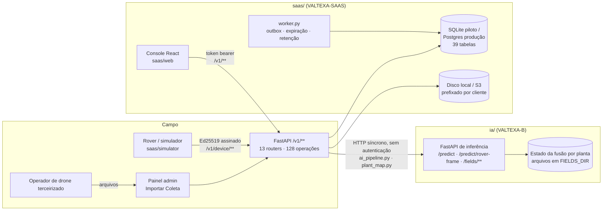

# Auditoria da plataforma ValTexa — Fase 0

> 02/10/2026. Feita sobre o código deste repositório (`ia/` = VALTEXA-B, `saas/` =
> VALTEXA-SAAS), não só sobre a documentação. Responde aos 10 itens da seção 66 do
> `docs/BRIEF_PLATAFORMA.md`. Os números de teste abaixo são da execução real nesta
> sessão.

---

## Números reais desta auditoria

| Suíte | Comando | Resultado |
| --- | --- | --- |
| SaaS — pytest | `cd saas && python -m pytest` | **484 passed** em 3 min 41 s (SQLite) |
| SaaS — lint | `cd saas && ruff check .` | **All checks passed** |
| Console — build | `cd saas/web && npm ci && npm run build` | **verde** (tsc + vite) |
| Console — vitest | `cd saas/web && npx vitest run` | **14 passed** (1 arquivo) |
| IA — pytest | `cd ia && KERAS_BACKEND=torch python -m pytest` (Python 3.12) | **703 passed** em 6 min 23 s, com o dublê do modelo |
| IA — lint | `cd ia && ruff check .` | 5 erros, todos nos arquivos de terreno intocáveis (já conhecidos) |

Observações de ambiente, todas reais:

- `pytest` puro dentro de `saas/` falha na coleta (`ModuleNotFoundError: valtexa`) porque o
  `pyproject.toml` não declara `pythonpath`; `python -m pytest` funciona. Corrigido na Fase 2
  (`pythonpath = ["."]`).
- O README do SaaS fala em "257 testes" e "357 testes" em lugares diferentes; a suíte real tem
  **484**.
- A IA exige **Python ≥ 3.12** (`numpy==2.5.3`); com 3.11 a instalação é recusada. O índice de
  wheels CPU do PyTorch está bloqueado pela rede desta nuvem; o torch veio do PyPI.
- Com o FastAPI 0.142 instalado, `app.routes` devolve os roteadores incluídos de forma
  preguiçosa (`_IncludedRouter`): quem quiser enumerar rotas deve usar `app.openapi()` (é o
  que o teste de isolamento da Fase 2 faz).

---

## 1. Arquitetura atual

- **Dois serviços Python independentes**, ligados por HTTP: a plataforma (`saas/`) não carrega
  Keras/torch; a IA (`ia/`) não conhece banco, clientes nem telas. Essa separação já existe e é
  boa (brief, seção 4).
- **Não existe Rover Runtime nem Edge AI como pacote.** O "rover" hoje é o simulador
  (`saas/simulator/`) e o cliente de referência `saas/simulator/client.py`. O README da IA
  diz que "o mesmo código roda na Jetson com `INFERENCE_RUNTIME=onnx`", mas não há aplicação
  embarcada: nada de captura, buffer, fila de sincronização, política de retenção ou gestão de
  modelo no robô.
- Na raiz há resíduo do repositório anterior: `app/active_learning.py`, `tests/` e
  `pyproject.toml` (`valtexa-active-learning`). `app/active_learning.py` é **idêntico** a
  `ia/app/active_learning.py` — duplicação a remover quando o Pedro confirmar (não removido
  nesta fase: regra 56).

## 2. Stack

| Camada | Tecnologia (versões reais instaladas) |
| --- | --- |
| API da plataforma | Python 3.11, FastAPI 0.142, Starlette 1.7, Pydantic 2, SQLAlchemy 2.0, Alembic |
| Banco | SQLite (padrão/piloto) · Postgres 16 (produção, `docker-compose.yml`); polígonos em JSON, sem PostGIS |
| Objetos | `LocalObjectStore` (disco) ou `S3ObjectStore` (boto3), chave prefixada por cliente |
| Autenticação de pessoas | token próprio HMAC-SHA256 (tipo JWT HS256 sem cabeçalho) + linha `user_session` revogável; senha scrypt |
| Autenticação de robôs | Ed25519 por requisição (key-id, timestamp, nonce queimado em transação própria) |
| Comando de missão | assinatura da plataforma (`COMMAND_SIGNING_SECRET`), verificada pelo robô |
| Eventos | outbox transacional (`outbox_event`) + drenador em thread/worker; SSE em `/v1/stream` |
| Console | React 19, TypeScript, Vite, Tailwind, React Query, Leaflet, Recharts, three.js; tipos gerados do OpenAPI |
| IA | Python ≥ 3.12, FastAPI, Keras 3 (backend torch), ONNX Runtime opcional, SigLIP (transformers), TensorFlow só no treino, dNATY (BSL 1.1) no treino das cabeças |
| Infra | Dockerfile + docker-compose (API, worker, Postgres); IA fora do compose (GPU) |

## 3. Componentes

### `saas/valtexa/`

| Pasta | Conteúdo |
| --- | --- |
| `models/` | 39 tabelas: `tenancy` (tenant, user, membership, user_session), `farm` (farm, field, zone), `fleet` (device_model, device, device_credential, provisioning_token), `operations` (mission, segmentos, checkpoints, telemetria, eventos), `perception` (asset, observation, detection, diagnosis, decision, safety_evaluation), `agro` (product, batch, tank, application, verification), `collection`, `dataset` (dataset, sample, version, model_version), `scan` (3D), `platform_` (audit_entry, outbox_event, used_nonce, processing_job) |
| `api/routers/` | `auth` (15 op.), `farms` (12), `fleet` (7), `device_protocol` (14), `missions` (13), `perception` (8), `plants` (4), `agro` (11), `twin` (8), `console` (7), `collections_api` (3), `admin` (23), `stream` (1); mais `/health` e o catch-all do console |
| `api/deps.py` | `current_principal` (usuário + tenant + papel), `require(...)`, `require_platform_admin`, `scoped`/`get_scoped` (filtro de tenant), `current_device` |
| `security/` | `rbac.py` (capacidades por papel), `tokens.py`, `passwords.py`, `signing.py` |
| `services/` | `ai_pipeline` (chamada à IA + dupla validação), `plant_map` (repasse da fusão por planta), `decision_engine`, `safety_engine` (independente), `mission_manager`, `ingestion` (idempotente por dispositivo+sequência), `collections`/`collection_ingest` (upload em pedaços), `dataset`, `storage`, `events`, `audit`, `retention`, `twin`, `planner`, `elevation`, `scene`/`pointcloud` (3D), `hal` (capacidades do hardware) |
| `worker.py` | drena outbox, expira missões, marca dispositivo offline, retenção |

### `ia/app/`

`main.py` (/health, /models, /classes, /predict, /predict/batch, /predict/explain, revisão),
`rover_api.py` (`/predict/rover-frame`), `fields_api.py` (/fields: plantas, mapa, passadas,
incidência, prescrição, prevalência), `plant_fusion.py` (fusão multivista calibrada),
`prescricao.py`, `registry.py` (catálogo estático de modelos), `onnx_runtime.py`,
`inference/` (novidade, conformal, qualidade, explicação, prior shift, cabeças),
`training/` (treino, calibrações, export ONNX). Arquivos de terreno (`basemap`, `boundary`,
`obstacles`, `terrain`, `terrain_api`) são de outra pessoa e estão fora desta auditoria de
mudança.

### Rotas, por tipo de chamador (gerado de `app.openapi()` e das dependências)

| Tipo | Operações |
| --- | --- |
| Usuário com cliente ativo (`current_principal`) | 86 |
| Plataforma (`require_platform_admin`) | 23 |
| Dispositivo assinado (`current_device`) | 14 |
| Usuário sem cliente (`/auth/memberships`) | 1 |
| Públicas (`/auth/login`, `/device/provision`, `/device/time`, `/health`, console) | 5 |
| **Total** | 129 (128 no OpenAPI + o catch-all do console) |

## 4. O que funciona (verificado por teste)

- Cadastro de cliente, fazenda, talhão (contorno, área, azimute, espaçamento entre **ruas**,
  modelo de IA), zona; usuários e papéis por cliente; sessões revogáveis; troca/redefinição de
  senha derrubando sessões.
- **Isolamento por tenant na consulta**: `scoped()`/`get_scoped()` filtram por `tenant_id` da
  linha e devolvem 404 (não 403) para recurso de outro cliente. Há testes pontuais
  (`test_security.py`, `test_acesso_e_trilha.py`), mas **não** cobrindo todas as rotas.
- Protocolo do dispositivo: provisionamento por convite, Ed25519 por requisição, nonce
  anti-replay, ingestão idempotente por `(dispositivo, sequência)`, imagem deduplicada por
  `sha256` dentro do cliente.
- Missões: máquina de estados, cobertura em segmentos, safety engine independente (falha
  fechada), comando assinado, aprovação de aplicação exclusiva do agrônomo.
- Percepção: dupla validação, fila do agrônomo com prioridade por aprendizado ativo, decisão por
  regras, verificação pós-aplicação.
- Coletas aéreas: upload em pedaços retomável, fila (`processing_job`), publicação para o
  cliente; dataset proprietário com corte congelado.
- Outbox transacional, SSE, auditoria (`audit_entry`) em quase toda escrita.
- Migrações Alembic 0001–0009 com teste que compara o esquema migrado ao dos modelos e testa
  ida e volta.
- Console React cobrindo todas as rotas usadas (não há tela sem backend; o contrário — rota sem
  tela — acontece em `/v1/fields/{id}/anomalies` etc., que têm tela).
- IA: inferência, conformal, novidade, portão de enquadramento, fusão por planta, incidência e
  prescrição **com os dublês dos testes**. Os pesos não estão neste repositório, então a
  inferência real **não roda aqui**.

## 5. O que está incompleto ou simulado

| Item | Situação real |
| --- | --- |
| `SIMULATED_INFERENCE=true` | troca a IA por `SimulatedAnalyzer` (lê um marcador na imagem); padrão da suíte e do simulador; recusado em produção por `production_problems()` |
| Fusão por planta no SaaS | `plant_map.py` só repassa a IA; com inferência simulada responde 503 ("sem serviço de inferência") |
| Incidência e prescrição da IA | existem na IA (`/fields/{id}/incidence`, `/fields/{id}/prescription`) e **não têm rota no SaaS** |
| Decisão | `decision_engine` decide por fração de observações, não pela fusão por planta |
| Edge AI / Rover Runtime | **inexistente**; o rover manda o quadro inteiro para a nuvem |
| Buffer circular, retenção no robô, fila de sync priorizada com chunks | inexistentes |
| Model Registry (seção 9) | `ModelVersion` é só registro de treino; o catálogo real é estático em `ia/app/registry.py`; sem estados TREINAMENTO→PRODUÇÃO, sem aprovação, sem dNATY, sem artefato original × otimizado |
| OTA | inexistente |
| Planos e limites | `Tenant.contracted_service` é **texto livre**; nada limita nada |
| Papéis da plataforma | uma flag só (`User.is_platform_admin`) |
| "Entrar como cliente" | não existe como sessão: o admin de plataforma entra em **qualquer** cliente, silenciosamente, como `ADMIN` com escrita total |
| Consentimento para treino | inexistente; `dataset.record_review` grava amostra de qualquer cliente |
| Talhão | sem espaçamento **entre plantas**, nº de linhas, fileiras de validação, observações |
| Convite por e-mail, notificações, suporte/chamados, relatórios PDF/CSV | inexistentes |
| Firmware, drone próprio | fora do escopo, documentado como tal (rota de drone responde 501 — correto pela seção 55) |
| Cópia 3D | roda sobre plantas simuladas (sem driver do LiDAR) |

## 6. Problemas críticos

Em ordem de gravidade.

1. **Acesso silencioso da equipe ValTexa a qualquer cliente, com escrita** (`deps.current_principal`,
   linha "membership is None → Role.ADMIN"). Viola as seções 27 e 29: sem motivo, sem prazo,
   sem somente-leitura, sem faixa, sem registro de entrada/saída. Uma conta de plataforma
   vazada lê e altera todos os clientes.
2. **Uma flag só para a equipe** (`is_platform_admin`): suporte, comercial e IA têm o mesmo
   poder total. Viola menor privilégio (seção 36).
3. **Dados de cliente entram no dataset sem consentimento** (`services/dataset.py::record_review`
   é chamado a cada revisão). Viola a seção 32 e é risco LGPD.
4. **Rover envia quadro inteiro para a nuvem e a inferência é síncrona na requisição do robô**
   (`device_protocol._analyses` chama a IA antes da transação). Viola as seções 4, 12, 13 e 14
   (sem internet, sem IA; 864 GB/dia/rover inviáveis) e acopla a latência da IA ao protocolo.
5. **IA sem autenticação**: `ia/app/main.py` não tem nenhuma credencial; qualquer um na rede
   chama `/predict`, lê `/fields/{id}/plants` de qualquer talhão e fecha passadas. O isolamento
   do SaaS acaba na fronteira HTTP com a IA. O `field_id` é UUID (difícil de adivinhar), o que
   reduz mas não elimina o risco.
6. **Sem planos/limites**: nada impede um cliente de criar fazendas, rovers e missões sem fim
   (seção 31) — risco de custo e de abuso.
7. **Estado da fusão por planta em arquivos locais da IA** (`FIELDS_DIR`): não escala para
   mais de uma réplica da IA, sem backup transacional, fora do banco da plataforma.
8. **SQLite como padrão** (já avisado em `/health`); produção exige Postgres.
9. **Sem limitação de tentativas no login** (nenhum rate limit em `/v1/auth/login`).
10. **Escalada dentro do cliente**: um `ADMIN` do cliente podia convidar ou promover alguém a
    `OWNER` (papel com `tenant:manage`), que tem mais capacidade que ele. **Corrigido na Fase 2**
    (só o dono mexe em dono).
11. **Convite sem aceite**: `POST /v1/users` com o e-mail de uma conta que já existe associa
    essa conta ao cliente de quem convida, sem a pessoa aceitar. Não dá acesso ao dado do outro
    cliente (o teste de isolamento cobre), mas a conta passa a ver o cliente do convidante —
    vetor de engenharia social. Resolver com convite por e-mail e aceite (PLANO_SAAS, seção 4).

## 7. O que separar

| Hoje | Deve ir para | Por quê |
| --- | --- | --- |
| Captura/decisão de retenção (inexistente) e "IA no robô" (ia/ rodando na Jetson) | `rover/` — **Rover Runtime** + **Edge AI** (novo pacote) | seção 4, 11, 54: offline-first, independente do SaaS |
| `ia/app/` servindo SaaS e robô ao mesmo tempo | `ia/` = **AI Platform** (cloud); o motor de inferência embarcável sai como biblioteca (`ia/app/inference`, `rover.py`, `onnx_runtime.py`) consumida pelo `rover/` | uma implementação, dois implantes |
| `saas/simulator/` (fala o protocolo) | continua, mas passa a usar o `rover/` (mesmo Edge AI e mesmo Sync Engine — seção 41) | |
| Rotas de plataforma (`/v1/admin/**`) dentro do mesmo console do cliente | **Console interno** `/v1/platform/**` + `/plataforma` no web, com papéis próprios | seção 28 |
| `ModelVersion` + `registry.py` estático | **Model Registry** na AI Platform com estados e aprovação; SaaS só lê o que está liberado | seção 9 |
| Arquivos de fusão em `FIELDS_DIR` | banco da AI Platform (metadados) + object storage | seção 37/38 |
| Raiz `app/`, `tests/`, `pyproject.toml` | remover (duplicado de `ia/`) | duplicação |

## 8. Arquitetura alvo

Detalhada em `docs/ARQUITETURA.md` (Fase 1): componentes A–G mapeados para pastas reais,
contratos Rover↔Backend, SaaS↔Backend, AI Platform↔Backend e Fleet↔Rover, modelo de dados,
armazenamento, eventos, idempotência e o plano de migração.

## 9. Plano de migração sem destruir o que existe

Resumo (o detalhado está em `docs/ARQUITETURA.md`, seção "Migração"):

1. **Somar antes de tirar.** Coluna nova com migração Alembic e preenchimento a partir da
   antiga (`is_platform_admin` → `platform_role`; `contracted_service` → `Subscription` com o
   texto preservado em `notes`); a antiga só sai numa fase posterior, quando nada a ler.
2. **Mesmo contrato HTTP** enquanto o console não migra: rotas novas ao lado das antigas;
   campos novos opcionais nas respostas.
3. **Toda mudança de segurança com teste negativo** (403/404) antes do positivo.
4. **Rover Runtime nasce ao lado**, falando o protocolo `/v1/device/**` que já existe; o
   simulador passa a usá-lo; só depois o protocolo ganha upload por prioridade e chunks.
5. A IA ganha autenticação de serviço (token entre SaaS e IA) sem mudar as rotas.

## 10. Primeira fase a implementar

**Fase 2 — backend, banco, autenticação e multi-tenancy** (feita nesta sessão; ver
`docs/PROGRESSO.md`):

- `User.platform_role` com cinco papéis e capacidades próprias (menor privilégio), migrando
  `is_platform_admin=true` → `superadmin`;
- "Entrar como cliente" com sessão de suporte: motivo, prazo, somente leitura por padrão, modo
  assistido explícito, auditoria de toda ação com o interno e o cliente, saída registrada;
  o acesso silencioso de hoje deixa de existir para quem não é superadmin;
- planos reais (`Plan`, `Subscription`, `UsageCounter`) com limites verificados nas rotas que
  criam fazenda, talhão, dispositivo, usuário e missão;
- consentimento SIM/NÃO para uso dos dados em treino, padrão NÃO, com o dataset recusando
  amostra sem consentimento;
- talhão com espaçamento entre plantas, nº de linhas, fileiras de validação e observações;
- teste de isolamento gerado do OpenAPI cobrindo todas as rotas e teste de escalada de
  privilégio.
